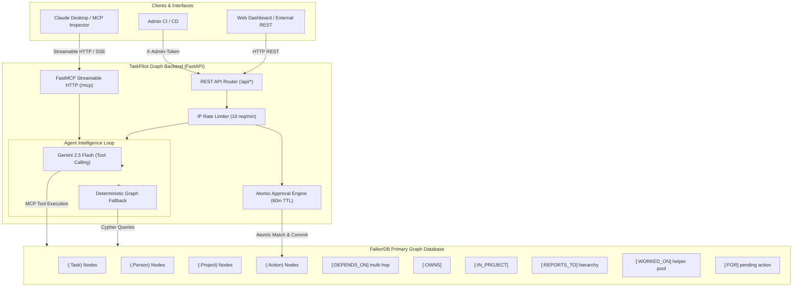

# TaskPilot Graph 🧭⚡

> **Autonomous AI Agent Acting on Connected Project Data**  
> Built for the **Graph Hacks: Context for AI Agents** Hackathon  
> **Track 01**: *Agents That Act on Connected Data*

[](https://www.python.org/)
[](https://falkordb.com/)
[](https://fastapi.tiangolo.com/)
[](https://modelcontextprotocol.io/)
[](LICENSE)

---

## Repository Layout

- **`backend/`**: Python FastAPI backend powered by FalkorDB graph database and FastMCP (Streamable HTTP at `/mcp`). Provides graph traversal tools, impact ranking, escalation chains, and human-in-the-loop approval workflows.
- **`frontend/`**: Interactive React/Vite dashboard connecting to the backend via REST/MCP (run with `cd frontend && npm install && npm run dev`).

---


## 1. Executive Summary & Problem Statement

Modern projects fail not from a lack of task tracking, but from **invisible dependency cascades**. In typical linear issue trackers, every overdue task looks like an isolated card with a red date. In reality, one overdue foundational task (such as database migrations or backend testing) silently halts dozens of downstream contributors across multiple teams.

**TaskPilot Graph** transforms project management by treating projects, tasks, people, dependencies, and approval actions as a **live, connected knowledge graph in FalkorDB**. 

Rather than relying on flat relational lookups, TaskPilot Graph:
1. **Traverses multi-hop dependency chains** (`(:Task)-[:DEPENDS_ON*1..6]->(:Task)`) to measure downstream blast radius.
2. **Ranks overdue tasks by systemic impact**, automatically prioritizing tasks that block others over isolated delays.
3. **Traverses management escalation hierarchies** (`(:Person)-[:REPORTS_TO*1..3]->(:Person)`) to identify managerial accountability and colleague cross-staffing options (`[:WORKED_ON]`).
4. **Enforces human-in-the-loop approval**: Drafts context-aware reminders referencing specific blocked blockers and potential helpers, but strictly requires explicit human sign-off via cryptographic Action nodes before any action takes effect.
5. **Exposes tools natively via the Model Context Protocol (MCP)** and REST, allowing external AI clients (Claude Desktop, Cursor, Gemini, MCP Inspector) or custom web dashboards to interact with connected project intelligence.

---

## 2. System Architecture



---

## 3. Graph Data Model & Schema

All state is stored exclusively in **FalkorDB** inside graph `taskpilot`. There is **zero shadow in-memory or relational storage**.

### Nodes

| Node Label | Key Properties | Purpose |
| :--- | :--- | :--- |
| `(:Task)` | `id` (int), `name` (str), `deadline` (YYYY-MM-DD), `status` (str), `reminderSent` (bool), `reminderSentAt` (ISO str) | Work items with relative UTC dates and completion status |
| `(:Person)` | `name` (str), `email` (str) | Team members, task owners, and organizational managers |
| `(:Project)` | `name` (str) | High-level initiatives grouping work and contributors |
| `(:Action)` | `id` (str), `state` ('pending'\|'approved'), `message` (str), `createdAt` (ISO str) | Ephemeral pending actions subject to human approval |

### Relationships

| Relationship | Direction | Description |
| :--- | :--- | :--- |
| `(:Task)-[:DEPENDS_ON]->(:Task)` | Directed `(blocked)-[:DEPENDS_ON]->(blocker)` | Multi-hop dependency path. Task A cannot proceed until Task B completes. |
| `(:Person)-[:OWNS]->(:Task)` | Directed `(owner)-[:OWNS]->(task)` | Direct accountability and task ownership. |
| `(:Task)-[:IN_PROJECT]->(:Project)` | Directed `(task)-[:IN_PROJECT]->(project)` | Project boundary membership. |
| `(:Person)-[:REPORTS_TO]->(:Person)` | Directed `(employee)-[:REPORTS_TO]->(manager)` | Multi-tier reporting hierarchy for automatic managerial escalation. |
| `(:Person)-[:WORKED_ON]->(:Project)` | Directed `(collaborator)-[:WORKED_ON]->(project)` | Subject matter expertise graph for finding unblocking helpers. |
| `(:Action)-[:FOR]->(:Task)` | Directed `(action)-[:FOR]->(task)` | Binds a human approval proposal strictly to its target task node. |

---

## 4. Why FalkorDB is Strictly Load-Bearing

> **Verification #5 Disconnect Proof**: Setting `FALKORDB_HOST` to an unreachable port causes the application to immediately fail with database connection errors. No fallback or mock storage exists in production.

FalkorDB is not used as a superficial cache or document store; it is the **computational backbone** of the product:

1. **Multi-Hop Dependency Traversal**: Relational databases require recursive Common Table Expressions (CTEs) with expensive multi-table self-joins that quickly degrade on variable-depth paths. FalkorDB computes `(:Task)-[:DEPENDS_ON*1..6]->(:Task)` in linear graph-matrix space.
2. **Impact-Driven Dynamic Ranking**: Ranking is not a static field; it is computed by counting distinct downstream reachable nodes `count(DISTINCT blocked)` across the active dependency topology.
3. **Escalation Path Discovery**: Determining the direct manager and higher-level escalation chains is solved via variable-depth openCypher `(:Person)-[:REPORTS_TO*1..3]->(:Person)`.
4. **Collaborative Helper Discovery**: Uncovering team members who have context on the project without owning the blocked task is a graph pattern match: `(t)-[:IN_PROJECT]->(pr)<-[:WORKED_ON]-(h:Person) WHERE NOT (h)-[:OWNS]->(t)`.
5. **Anti-Forgery Atomic Human-in-the-Loop Commits**: Actions are materialized as `(:Action)` nodes with a 60-minute time-to-live. Approvals perform an atomic openCypher commit that strictly matches the existing graph edge `(:Action)-[:FOR]->(:Task)` rather than trusting client-provided text.

---

## 5. Cypher Query Catalog

Every decision made by the agent and API is grounded in documented openCypher queries:

### 1. Multi-Hop Downstream Blocker Traversal
```cypher
// Traverses 1 to 6 hops of DEPENDS_ON edges to identify all downstream tasks blocked by $task_id
MATCH path = (blocked:Task)-[:DEPENDS_ON*1..6]->(target:Task {id: $task_id})
OPTIONAL MATCH (p:Person)-[:OWNS]->(blocked)
RETURN blocked.id AS id, blocked.name AS name, blocked.status AS status,
       blocked.deadline AS deadline, p.name AS owner,
       length(path) AS depth,
       [n IN nodes(path) | n.name] AS path_names
ORDER BY depth ASC, blocked.id ASC
```

### 2. Overdue Impact Ranking (Tie-Breaking Algorithm)
```cypher
// Finds overdue tasks and counts distinct downstream tasks blocked by each
MATCH (p:Person)-[:OWNS]->(t:Task)-[:IN_PROJECT]->(pr:Project)
WHERE t.deadline < $today_utc AND toLower(trim(t.status)) <> 'done'
OPTIONAL MATCH (blocked:Task)-[:DEPENDS_ON*1..6]->(t)
WITH t, p, pr, count(DISTINCT blocked) AS blocks_count
RETURN t.id AS id, t.name AS name, t.deadline AS deadline, t.status AS status,
       t.reminderSent AS reminderSent, p.name AS owner, p.email AS email,
       pr.name AS project, blocks_count
```
*Application sorts: `(-blocks_count, -days_overdue, task_id)` ensuring Task 3 (blocks 2) outranks Task 1 (blocks 1) and Task 7.*

### 3. Management Escalation Chain
```cypher
// Finds task owner and traverses the management reporting tree up to 3 levels
MATCH (p:Person)-[:OWNS]->(t:Task {id: $task_id})
OPTIONAL MATCH path = (p)-[:REPORTS_TO*1..3]->(m:Person)
RETURN p.name AS owner, p.email AS email,
       [n IN nodes(path) | n.name] AS chain
```

### 4. Cross-Project Helper Discovery
```cypher
// Identifies colleagues who WORKED_ON the task's project but do not own this specific task
MATCH (t:Task {id: $task_id})-[:IN_PROJECT]->(pr:Project)<-[:WORKED_ON]-(h:Person)
WHERE NOT (h)-[:OWNS]->(t)
RETURN DISTINCT h.name AS name, h.email AS email, pr.name AS project
ORDER BY h.name ASC
```

### 5. Atomic Human Approval Commit
```cypher
// Atomically verifies action existence, TTL, and commits reminder execution
MATCH (a:Action {id: $action_id})-[:FOR]->(t:Task)
SET t.reminderSent = true,
    t.reminderSentAt = $now_iso,
    a.state = 'approved'
RETURN t.id AS taskId
```

### 6. Native Matrix PageRank Criticality (Optional Tool)
```cypher
// Executes FalkorDB's native graph algorithm engine to score topological criticality
CALL algo.pageRank('Task', 'DEPENDS_ON')
YIELD node, score
RETURN node.id AS id, node.name AS name, score
ORDER BY score DESC
```

---

## 6. MCP Tool Catalog

The backend exposes a full suite of Model Context Protocol (MCP) tools at `/mcp` via FastMCP:

| Tool Name | Type | Signature | Description & Evidence |
| :--- | :--- | :--- | :--- |
| `get_tasks` | Read | `()` | Lists all tasks with owner and project metadata. Traces `[:OWNS]` and `[:IN_PROJECT]`. |
| `find_overdue_tasks` | Read | `()` | Evaluates tasks against UTC date where `deadline < today` and `status != 'Done'`. |
| `get_blocked_downstream` | Read | `(task_id: int)` | Computes variable-length paths `[:DEPENDS_ON*1..6]`. Returns depth and path names. |
| `rank_overdue_by_impact` | Read | `()` | Ranks overdue tasks by systemic downstream impact (`blocksCount DESC, daysOverdue DESC, taskId ASC`). |
| `get_task_owner` | Read | `(task_id: int)` | Resolves task owner, email, direct manager, and multi-tier escalation chain via `[:REPORTS_TO]`. |
| `find_helpers` | Read | `(task_id: int)` | Queries peer team members who `[:WORKED_ON]` the same project to offer unblocking help. |
| `draft_reminder` | Read | `(task_id: int)` | Drafts context-aware reminder referencing blocked tasks, helpers, and manager CC. Warns human approval required. |
| `update_task_status` | Write | `(task_id: int, status: str)` | Updates task status in FalkorDB (e.g. 'Done', 'In progress'). Warns that completing tasks unblocks downstream items. |
| `get_pagerank_criticality` | Advanced | `()` | Executes native FalkorDB GraphBLAS PageRank algorithm on dependency topology. |

---

## 7. REST API Reference

All REST endpoints support CORS and return JSON:

- **`GET /`**: Healthcheck, version, and database status.
- **`GET /api/tasks`**: Returns array of all 8 tasks with ownership, project, and reminder state.
- **`GET /api/graph`**: Visual graph representation (`{ nodes: [...], edges: [...] }`) for dashboard rendering.
- **`POST /api/agent`**:
  - Body: `{"instruction": "string (optional, max 500 chars)"}`
  - Rate limited to 10 requests/minute per client IP (HTTP 429 with `Retry-After`).
  - Runs Gemini 2.5 Flash tool calling or deterministic graph-driven fallback.
  - Persists drafted actions as `(:Action)` nodes in FalkorDB.
- **`POST /api/approve`**:
  - Body: `{"actions": [{"id": "act_..."}]}` or `{"actionIds": ["act_..."]}`
  - Verifies 60-minute TTL expiry, anti-forgery, and idempotency.
  - Updates `t.reminderSent = true` and `a.state = 'approved'`.
- **`POST /api/admin/reset`**:
  - Header: `X-Admin-Token: <ADMIN_TOKEN>`
  - Clears graph and seeds synthetic organization, tasks, and dependency topology with relative UTC dates.
- **`ANY /mcp`**: FastMCP streamable HTTP endpoint for MCP clients.

---

## 8. Quickstart & Local Setup

### Option A: Running with Docker Compose (Recommended)

Spins up FalkorDB and TaskPilot Graph in isolated containers:

```bash
# 1. Clone repository
git clone https://github.com/<your-username>/taskpilot-graph.git
cd taskpilot-graph

# 2. Configure environment (optional Gemini API key)
cp .env.example .env

# 3. Launch FalkorDB and backend
docker compose up --build
```
The API is live at `http://localhost:8000` and FalkorDB at `localhost:6379`.

---

### Option B: Local Python Development

#### 1. Start FalkorDB
```bash
docker run -p 6379:6379 -it --rm falkordb/falkordb:latest
```
*(Or connect to a free instance on [FalkorDB Cloud](https://app.falkordb.cloud/)).*

#### 2. Install Dependencies & Start Server
```bash
cd taskpilot-graph
python -m venv .venv
source .venv/bin/activate  # On Windows: .venv\Scripts\activate
pip install -r requirements.txt

# Start backend
uvicorn app.main:app --host 127.0.0.1 --port 8000 --reload
```

---

## 9. Verification & Automated Testing

### 1. Pytest Suite
Run the 14-point test suite covering input validation, ranking algorithms, TTL expiry, rate limiting, and the disconnect test:

```bash
pytest tests/ -v
```

### 2. End-to-End Smoke Test
Run the live smoke suite against a running server:

```bash
python scripts/smoke.py
```

The smoke suite verifies:
1. Root healthcheck & FalkorDB connection
2. Admin authentication security (`401 Unauthorized` on bad tokens)
3. Graph resetting and UTC relative date seeding
4. Task schema listing and graph visualization export
5. Instruction validation (`> 500` chars rejected)
6. Agent execution and impact ranking order `[Task 3, Task 1, Task 7]`
7. Action node creation and persistence in FalkorDB
8. Anti-forgery rejection of fake/unrecognized action IDs
9. Human approval execution and duplicate suppression (`result: skipped`)
10. State persistence in FalkorDB (`reminderSent: true`)
11. IP rate limiting (10 requests/minute)
12. FastMCP streamable mount at `/mcp`

---

## 10. Live Deployment Guide

### Deploying FalkorDB
1. Create a free database on **[FalkorDB Cloud](https://app.falkordb.cloud/)**.
2. Note your host, port, username, and password.

### Deploying FastAPI Backend (Render, Railway, Fly.io, or AWS)
Set the following environment variables in your deployment dashboard:
```ini
FALKORDB_HOST=<your-falkordb-host>
FALKORDB_PORT=<your-falkordb-port>
FALKORDB_PASSWORD=<your-falkordb-password>
FALKORDB_GRAPH=taskpilot
ADMIN_TOKEN=<strong-secret-token>
RATE_LIMIT_PER_MIN=10
GEMINI_API_KEY=<optional-gemini-key>
```
Run command:
```bash
uvicorn app.main:app --host 0.0.0.0 --port $PORT
```

---

## 11. Demo Video Script & Walkthrough Notes

When recording the 2-3 minute demo for the hackathon submission:

1. **The Hook (0:00 - 0:30)**:
   - Introduce the problem: "Overdue tasks aren't equal. If Task 3 is overdue, does it matter more than Task 7? In traditional tools, you can't tell."
   - Show the FalkorDB graph topology via `GET /api/graph` or browser.
2. **The Graph Traversal & Impact Ranking (0:30 - 1:15)**:
   - Trigger the agent audit via `POST /api/agent`.
   - Highlight the ranking output: Task 3 ("Test backend") is ranked #1 because it blocks 2 downstream tasks (`Finish frontend` and `Deploy to production`).
   - Show how Task 1 and Task 7 block only 1 task each.
3. **Contextual Action Synthesis (1:15 - 1:50)**:
   - Inspect the drafted reminder for Aman: it specifically names the blocked tasks, calculates days overdue, CCs manager Neha via the `REPORTS_TO` chain, and suggests Rahul as a helper from `WORKED_ON`.
   - Point out that the action is purely a proposal stored as an `(:Action)` node in FalkorDB.
4. **Human-in-the-Loop Approval (1:50 - 2:30)**:
   - Call `POST /api/approve` with the action ID.
   - Show the immediate result: Task 3's `reminderSent` is updated in FalkorDB.
   - Call approve a second time to show duplicate prevention (`result: skipped`).
5. **FalkorDB Load-Bearing Proof (2:30 - 2:50)**:
   - Conclude by demonstrating the disconnect test: without FalkorDB, the system cannot function because the intelligence lives entirely in the graph.

---

## 12. AI Assistant Disclosure

In accordance with hackathon rules, this project was developed with the assistance of an agentic AI coding assistant (Google Antigravity). All architectural patterns, FalkorDB Cypher queries, graph schemas, rate limiting, and verification suites were reviewed, validated, and explained by the author to ensure complete conceptual mastery and code reliability.

---

## 13. Accounts, Multi-Tenancy & Workspace Isolation

TaskPilot incorporates enterprise-grade multi-tenancy while keeping the public demo intact:

- **Supabase Authentication**:
  - Email/password authentication, registration with password strength indicators, and email confirmation workflows.
  - Anonymous guest sessions (`is_anonymous=true`) for friction-free exploration.
  - Frictionless guest upgrading: converts anonymous sessions into permanent email/password accounts with zero data loss.
- **Row-Level Security & Graph Isolation**:
  - All workspace operations forward the user's verified Supabase JWT directly to PostgREST with strict PostgreSQL Row-Level Security (RLS).
  - Every workspace receives a dedicated, isolated property graph in FalkorDB (`workspace_<uuid>`).
  - Strict graph safeguards: The system-level graph named `"taskpilot"` is permanently protected and refuses all deletion requests.
  - Task dependency graph creation enforces a **200-task cap** per workspace and prevents circular dependencies using a 3-color Depth-First Search (DFS) cycle detection algorithm.
- **Zero Breaking Changes for Public Demo**:
  - Requests without an `Authorization` header automatically target the public demo graph in read-only mode, guaranteeing complete backward compatibility.

---

## 14. Plans, Quotas & Razorpay TEST Billing

- **Subscription Tiers**:
  - **Free Tier (₹0)**: 10 autonomous agent runs / day, 5 LLM reasoning runs / day, 50 tasks / workspace, 1 workspace.
  - **Pro Tier (₹999 / 30 days)**: 500 agent runs / day, 200 LLM reasoning runs / day, 200 tasks / workspace, 10 workspaces, GitHub repository import enabled.
- **Server-Side Quota Enforcement**:
  - Quotas are enforced server-side before execution via the `consume_quota` PostgreSQL RPC function, returning `429 Too Many Requests` when limits are reached.
- **Razorpay TEST Gateway Integration**:
  - Server-side order creation using Razorpay Basic Auth (`RAZORPAY_KEY_ID`, `RAZORPAY_KEY_SECRET`). Secret keys are never returned to clients or logged.
  - Client-side checkout modal (`https://checkout.razorpay.com/v1/checkout.js`) with prominent **TEST MODE** badges.
  - Verification endpoint (`POST /api/billing/verify`) validates user ownership, verifies HMAC-SHA256 signature, verifies payment amounts directly with Razorpay, and extends subscriptions idempotently (+30 days).
  - Webhook endpoint (`POST /api/billing/webhook`) validates raw request body signatures and deduplicates events via the `webhook_events` table before applying mutations.
  - Comprehensive audit logging via `audit_log` table for all financial and workspace lifecycle events.

---

## 15. Rule-Based Help Assistant & Security Hardening

- **Deterministic Help Chatbot**:
  - Local rule-based knowledge base (`frontend/src/chatbot/kb.ts`) with typed topics, keyword matching, follow-up chips, and action shortcuts.
  - **Zero external AI dependencies**: runs entirely in browser memory.
  - **Strict plain-text rendering**: never uses `dangerouslySetInnerHTML`, `innerHTML`, or `eval()`.
  - Accessible slide-over widget with Esc key support and `aria-live="polite"` screen-reader compliance.
  - Human support fallback: submits tickets to the `support_requests` database table.
- **Cloudflare Edge Security**:
  - Cloudflare Pages `_headers` file enforces a strict Content Security Policy (`default-src 'self'`, whitelisted Razorpay and Cloudflare Turnstile origins).
  - `X-Content-Type-Options: nosniff`, `X-Frame-Options: DENY`, `Referrer-Policy: strict-origin-when-cross-origin`, `Strict-Transport-Security`.
- **Backend Request Hardening**:
  - 64KB request body size cap on all JSON endpoints to mitigate Denial-of-Service attacks.
  - Strict parameterized openCypher queries preventing Cypher injection.
  - Secret redaction in all logging and error responses.

---

## 16. Cron & Maintenance Cleanup

To automatically clean up expired guest workspaces and purge stale anonymous accounts older than 7 days, configure a recurring cron job:

```bash
# Run daily at 03:00 UTC
0 3 * * * curl -s -X POST https://api.yourdomain.com/api/admin/cleanup \
  -H "X-Admin-Token: $ADMIN_TOKEN"
```

The cleanup handler:
1. Validates the `X-Admin-Token` header.
2. Identifies workspaces where `expires_at < NOW()`, deletes their associated FalkorDB graphs (verifying the target is not `"taskpilot"`), and removes the workspace rows.
3. Queries Supabase Auth Admin API and purges anonymous user records older than 7 days.
4. Records all deletion events in the `audit_log` table.

